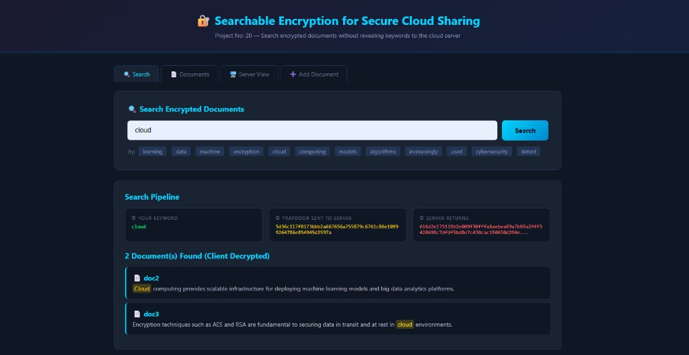

# Project No: 20 — Searchable Encryption for Secure Cloud Document Sharing

## Project Goal

To allow keyword search over encrypted research documents in the cloud.

## Screenshot



## Required Software

- Python 3.8+
- `cryptography` library

## Setup

```bash
pip install cryptography
```

## How to Run

### Automated Demo (all 5 tasks)

```bash
python main.py
```

### Interactive Command-Line Interface

```bash
python interactive.py
```

Opens a menu-driven CLI where you can:

- **Search for a keyword** — type any keyword and see the trapdoor, encrypted result, and decrypted matches
- **View all documents** — see the plaintext documents (client-side view)
- **See what the server sees** — only encrypted blobs, proving confidentiality
- **Add your own document** — type new content, then search for keywords from it
- **Compare client vs server view** — side-by-side proof that encryption works
- **View server search log** — proves the server never stores plaintext keywords
- **Show all indexed keywords** — see which keywords you can search for

### Web GUI (Browser Interface)

```bash
python web_app.py
```

Then open **http://localhost:5000** in your browser. Features:

- **Search tab** — type keywords and visually see the full encryption pipeline (keyword → trapdoor → encrypted result → decrypted documents)
- **Documents tab** — client (readable) vs server (encrypted) side-by-side comparison
- **Server View tab** — inspect the encrypted index and search log
- **Add Document tab** — add your own documents and search them

### Performance and Scalability Benchmarks

```bash
python test_performance.py
```

### Confidentiality Validation (27 security tests)

```bash
python test_confidentiality.py
```

## Project Structure

| File | Purpose |
|------|---------|
| `crypto_utils.py` | Core cryptographic primitives (AES-GCM, HMAC, key derivation) |
| `sse_scheme.py` | Searchable Symmetric Encryption scheme (index building, trapdoor, search) |
| `cloud_server.py` | Simulated cloud server storing encrypted documents and index |
| `client.py` | Client-side operations (upload, search, decrypt) |
| `main.py` | End-to-end demo of all project tasks |
| `interactive.py` | Interactive command-line interface for hands-on testing |
| `web_app.py` | Web-based GUI (open in browser at localhost:5000) |
| `test_performance.py` | Efficiency and scalability benchmarks |
| `test_confidentiality.py` | Confidentiality validation tests (27 checks) |

## Project Tasks

1. An encrypted keyword index is built for the cloud-stored documents.
2. A trapdoor mechanism is implemented so that users can search encrypted documents without revealing plaintext keywords.
3. The efficiency of encrypted search is tested by measuring query response times.
4. The confidentiality of documents is validated by ensuring that the cloud server cannot learn search terms.
5. The system is tested for scalability with a large number of documents.
